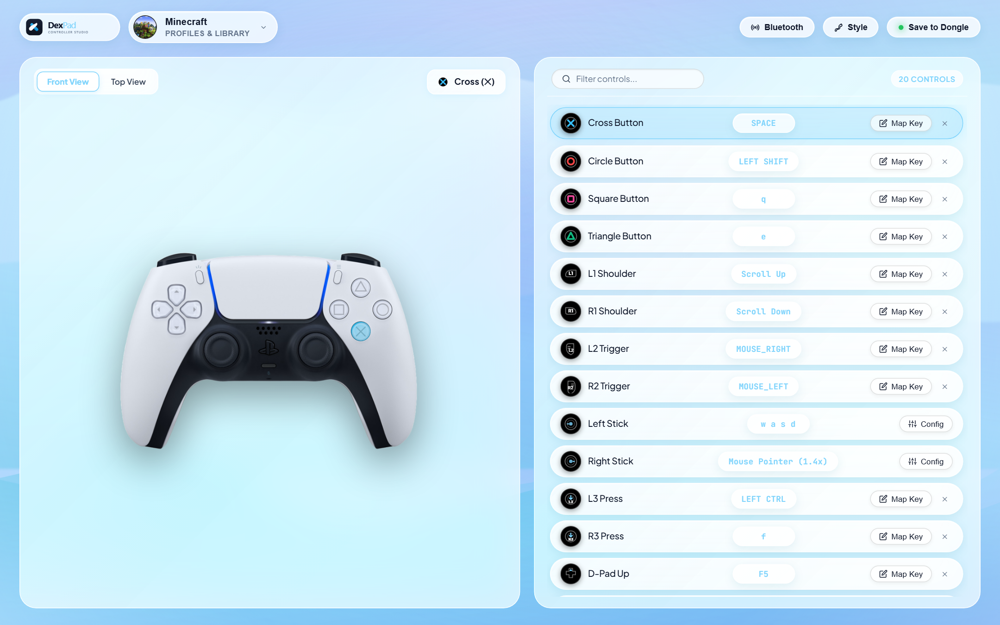

<div align="center">



# DexPad

**Universal Zero-Latency Controller-to-Keyboard/Mouse Bridge for macOS & Windows**  
*Transform any modern Bluetooth gamepad into native USB keyboard and mouse inputs at the hardware level—bypassing macOS's lack of X-Input with zero drivers, zero kexts, and zero background daemons.*

[](https://opensource.org/licenses/Apache-2.0)
[](https://www.raspberrypi.com/)
[](https://tauri.app/)

</div>

---

## Super Simple 3-Step Setup (For Non-Techies)

You do not need programming knowledge or command-line tools to use DexPad:

1. **Plug in your Pico**: Hold down the white **BOOTSEL** button on your **Raspberry Pi Pico 2 W** (or Pico W) and plug it into your Mac or PC using a standard USB-C cable.
2. **Open DexPad**: Launch the DexPad desktop application. DexPad automatically detects your board and asks: *"Blank Pico detected! Would you like to flash DexPad firmware?"* Click **"Flash DexPad Firmware"**. The app writes the firmware in 2 seconds and reboots the board into bridge mode.
3. **Pair and Play**: Put your controller into Bluetooth pairing mode (**PS + Share** on PlayStation, or the **Pair button** on Xbox, Switch Pro, or 8BitDo). The dongle connects automatically, gives a confirmation rumble, and you are ready to play.

---

## The Problem and The Solution

**The macOS Controller Dilemma:**  
macOS lacks native X-Input support. When playing games on Mac (Steam, native ports, indie titles, emulators, or cloud gaming), gamepad compatibility is fragmented. Games often fail to detect controllers, lack remapping options, or demand invasive background accessibility daemons and DriverKit entitlements.

**The DexPad Hardware Solution:**  
DexPad shifts the entire translation pipeline to an ultra-low latency hardware bridge powered by a **Raspberry Pi Pico 2 W** (RP2350), **Raspberry Pi Pico W** (RP2040), or **ESP32-S3**.
- Wirelessly pairs via Bluetooth with your favorite controller (**PlayStation DualSense**, **Xbox Wireless Controller**, **Nintendo Switch Pro**, or **8BitDo**).
- Plugs directly into your Mac via USB and enumerates as a **Native USB Composite HID (6KRO Keyboard + Optical Sub-pixel Mouse + Media Controls)**.
- macOS treats your controller as real hardware peripherals—**100% compatible with every Mac game out of the box.**

---

## System Architecture

```text
┌─────────────────────────────────┐
│     Any Bluetooth Gamepad       │
│  - PS5 DualSense / DualShock 4  │
│  - Xbox Wireless Controller     │
│  - Nintendo Switch Pro          │
│  - 8BitDo Ultimate / Pro 2      │
└───────────────┬─────────────────┘
                │ Bluetooth Low Latency
                ▼
┌─────────────────────────────────┐
│    DexPad USB Hardware Bridge   │
│  (Raspberry Pi Pico 2 W / ESP32)│
│  - Bluepad32 Bluetooth Host     │
│  - Onboard Profile Storage (NVS)│
│  - 125Hz Sub-Pixel Mouse Engine │
└───────┬─────────────────┬───────┘
        │ USB HID Keyboard│ USB CDC Serial
        │ & Mouse Input   │ (115200 Baud)
        ▼                 ▼
┌──────────────┐   ┌─────────────────────────────────┐
│  macOS Game  │   │      DexPad Desktop Studio      │
│  (Zero Kexts │   │     (Tauri v2 + Rust + Vue 3)   │
│   Zero Lag)  │   │  - Auto-Detection & 1-Click FW  │
└──────────────┘   │  - RAWG Library & Custom Maps   │
                   └─────────────────────────────────┘
```

---

## Features

- **Driverless Native Operation**: Zero driver installs, zero macOS system extension approvals, and zero accessibility prompts.
- **Automatic Dongle & Controller Detection**:
  - Automatically identifies DexPad hardware via USB VID (`0x2E8A` / `0x303A`) and handshakes over CDC serial.
  - Automatically detects connected gamepad models (PlayStation, Xbox, Nintendo Switch, 8BitDo) and adapts the 2D view and button legends (Cross/Circle vs. A/B vs. B/A) on the fly.
- **1-Click In-App Firmware Flasher**:
  - Connect a blank Raspberry Pi Pico W or Pico 2 W in BOOTSEL mode; DexPad detects the mount volume (`RPI-RP2` / `RP2350`) and flashes the bundled `.uf2` firmware directly with one click.
- **4 Onboard Hardware Profile Slots**:
  - Store 4 full game profiles directly on the dongle's non-volatile flash memory.
  - **Hardware Profile Switch Shortcut**: Hold **Home** and tap **D-Pad Left / Right** on your controller to switch profiles without opening the desktop app.
- **Game Library & RAWG Integration**:
  - Live search over 800,000 titles via the RAWG video game database to pull cover art, release details, and genre tags.
  - **Add Game Manually**: Create custom profiles with a live 600x900 card preview, custom genre chips, and starter presets (*3D FPS WASD+Mouse*, *2D Retro Platformer*, *Clean Slate*).
- **Sub-Pixel Smooth Mouse & Analog Curves**:
  - 125Hz throttled analog stick to mouse movement with remainder accumulation.
  - Selectable acceleration curves: *Linear*, *Exponential*, and *Aggressive*.
  - Configurable deadzones and inversion toggles.
- **Directional D-Pad & Analog Trigger Modes**:
  - Full support for 4-way, 8-way, and single-click directional mappings.
  - Analog trigger activation threshold customization (hair-trigger vs. full pull).
- **Apple and Modern Minimalist Aesthetic**:
  - VisionOS-inspired floating glass pill design with deep-space cosmic and sky-blue ambient themes.
  - Dynamic light/dark typography and responsive UI scaling.
- **3D Printable Snap-Fit Enclosure**:
  - Pre-modeled STEP, STL, and FreeCAD files for friction-peg snapless enclosures included in `case_3d/`.

---

## Hardware Requirements

| Hardware Component | Details |
| :--- | :--- |
| **Microcontroller Board** | **Raspberry Pi Pico 2 W** (RP2350, Recommended) or **Raspberry Pi Pico W** (RP2040) or **ESP32-S3** |
| **USB Cable** | Standard USB-C to USB-C / USB-A data cable |
| **Gamepad** | Any Bluetooth controller: PlayStation 5 DualSense, PS4 DualShock, Xbox Series/One Wireless, Nintendo Switch Pro, or 8BitDo |
| **Host System** | macOS 12+ (Apple Silicon M1/M2/M3/M4 or Intel) or Windows 10/11 |

*Note: No breadboards, soldering, or external components are required when using the Raspberry Pi Pico W or Pico 2 W.*

---

## Installation and Quick Start

### 1. Flash the Hardware Firmware

#### Option A: In-App 1-Click Flashing (Easiest)
1. Hold the white **BOOTSEL** button on your Raspberry Pi Pico W / Pico 2 W while plugging it into your computer's USB port.
2. Launch the **DexPad** desktop application.
3. DexPad displays a notification: *"Raspberry Pi Pico detected in BOOTSEL mode!"*
4. Click **Flash DexPad Firmware**. The app writes the bundled UF2 binary and reboots your Pico directly into dongle mode in approximately 2 seconds.

#### Option B: Manual Drag-and-Drop
1. Hold **BOOTSEL** and plug your Pico into your computer. A volume named `RPI-RP2` (or `RP2350`) will appear.
2. Copy the precompiled UF2 file from the repository into the drive:
   - For Pico 2 W (RP2350): `app/src-tauri/firmware/dexpad_pico2w.uf2`
   - For Pico W (RP2040): `app/src-tauri/firmware/dexpad_picow.uf2`
3. The board reboots automatically and blinks its LED to indicate it is ready to pair.

---

### 2. Pair Your Gamepad via Bluetooth

Place your controller into Bluetooth pairing mode:
- **PlayStation DualSense / DualShock 4**: Hold **Create/Share** + **PS Button** until the lightbar pulses rapidly.
- **Xbox Wireless Controller**: Turn on the controller, then hold the small circular **Pair** button on the top edge until the Xbox logo flashes fast.
- **Nintendo Switch Pro Controller**: Hold the small circular **Sync** button near the USB port until the bottom green LEDs cycle.
- **8BitDo Controllers**: Switch to Bluetooth mode (**S** or **X**), then hold the **Pair** button for 3 seconds.

The DexPad dongle automatically negotiates and saves the pairing keys to onboard flash. Once connected, your controller gives a brief rumble feedback.

---

### 3. Run the DexPad Desktop Studio

#### Prerequisites
- [Node.js 18+](https://nodejs.org/)
- [Rust & Cargo](https://rustup.rs/) (for Tauri desktop app compilation)

#### Development Run
```bash
# Clone the repository
git clone https://github.com/DevTheDev189/DexPad.git
cd DexPad

# Navigate to desktop app directory
cd app

# Install dependencies
npm install

# Start development app with hot-reloading
npm run tauri dev
```

#### Production Build
To create a signed, standalone native executable (`.dmg` for macOS, `.msi` / `.exe` for Windows):
```bash
npm run tauri build
```
The compiled release installer is located in `app/src-tauri/target/release/bundle/`.

---

## 3D Printable Enclosure

The `case_3d/` directory contains complete CAD source files and 3D print assets for housing your Pico 2 W dongle:

- `pico2w_case_top.stl` & `pico2w_case_bottom.stl` — Minimalist modern case featuring 4 internal solid alignment friction pegs (zero fragile clips, zero outer holes) and the debossed stepped DexPad logo.
- `pico2w_case_top_goth.stl` & `pico2w_case_bottom_goth.stl` — Gothic architectural pattern case with venting.
- CAD formats: `.step`, `.3mf`, and FreeCAD `.FCStd`.

**Recommended Print Settings:**
- **Material:** PETG or PLA
- **Layer Height:** 0.16mm or 0.20mm
- **Infill:** 20% Gyroid
- **Supports:** None (designed for bridge-free printing)

---

## Serial Protocol Specification (115200 Baud)

DexPad communicates with the hardware dongle using newline-delimited JSON (NDJSON) over USB CDC Serial:

### 1. PING / Heartbeat Handshake
```json
// Host -> Dongle
{"cmd": "PING"}

// Dongle -> Host
{
  "status": "ok",
  "device": "dexpad-pico2w",
  "fw": "2.0.0",
  "active_profile": 0,
  "controller_connected": true,
  "controller_type": "playstation",
  "controller_name": "DualSense Wireless Controller"
}
```

### 2. Switch Active Slot (SET_SLOT)
```json
// Host -> Dongle
{"cmd": "SET_SLOT", "slot": 1}

// Dongle -> Host
{"status": "ok", "msg": "slot_changed", "active_profile": 1, "name": "Minecraft"}
```

### 3. Write Profile (WRITE_PROFILE)
```json
// Host -> Dongle
{
  "cmd": "WRITE_PROFILE",
  "slot": 0,
  "name": "Minecraft",
  "sticks": {
    "left": {
      "mode": "digital_keys",
      "deadzone": 180,
      "up": "w", "down": "s", "left": "a", "right": "d"
    },
    "right": {
      "mode": "mouse",
      "deadzone": 45,
      "sensitivity": 1.35,
      "curve": "exponential",
      "invert_y": false
    }
  },
  "buttons": {
    "a": { "type": "key", "code": "KEY_SPACE" },
    "b": { "type": "key", "code": "KEY_LEFT_SHIFT" },
    "x": { "type": "key", "code": "q" },
    "y": { "type": "key", "code": "e" },
    "l1": { "type": "mouse_scroll", "delta": 1, "repeat_ms": 120 },
    "r1": { "type": "mouse_scroll", "delta": -1, "repeat_ms": 120 },
    "l2": { "type": "mouse_button", "code": "MOUSE_RIGHT", "threshold": 40 },
    "r2": { "type": "mouse_button", "code": "MOUSE_LEFT", "threshold": 40 },
    "l3": { "type": "key", "code": "KEY_LEFT_CTRL" },
    "r3": { "type": "key", "code": "f" },
    "dpad_up": { "type": "key", "code": "KEY_F5" },
    "dpad_down": { "type": "key", "code": "KEY_F3" },
    "dpad_left": { "type": "key", "code": "1" },
    "dpad_right": { "type": "key", "code": "t" },
    "menu": { "type": "key", "code": "KEY_ESC" },
    "options": { "type": "key", "code": "KEY_RETURN" },
    "home": { "type": "key", "code": "KEY_TAB" }
  }
}
```

---

## License

This project is open-source under the [Apache License 2.0](LICENSE).  
Copyright (c) 2026 Deven Winslow (DevTheDev189). Feel free to modify, build your own custom dongles, and share your game profiles!
